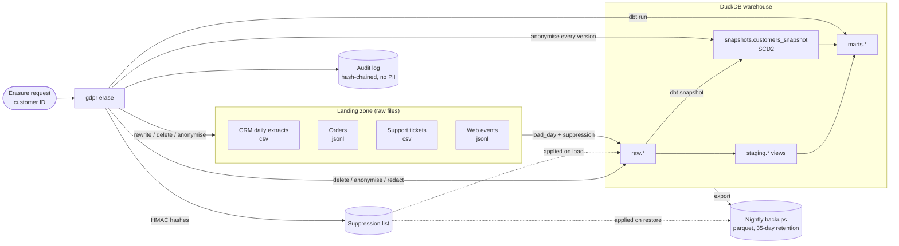

# GDPR deletion requests

A customer emails *"delete all my data."* Under GDPR Article 17 the company has one month to do it. The problem is that their data is not in one place: it is copied across raw landing files, warehouse tables, dbt models, nightly backups and, hardest of all, **SCD Type 2 history tables, which by design keep every past version of a record.**

This project is a working erasure workflow for a small, fake Finnish web shop. Give it a customer ID and it:

1. finds every identifier the person has ever had, including old emails and addresses that only survive in SCD2 history
2. scans raw files, every warehouse table and view, and every backup for those values, and flags any copy missing from the data map
3. deletes, anonymises or redacts each copy according to the data map
4. anonymises every SCD2 version in place instead of deleting history
5. rebuilds the dbt models
6. puts keyed hashes of the person on a suppression list, so restoring a backup or a CRM re-send cannot bring them back
7. re-scans to prove nothing is left, then writes a hash-chained audit entry that records what was removed and when **without storing the personal data itself**

Stack: Python, DuckDB, dbt (snapshots for SCD2), Streamlit, pytest.

<!-- Screenshot: docs/images/discover.png -->
<!-- Screenshot: docs/images/erase_result.png -->

## Architecture



## The hard part: SCD2 history

The demo customer `C00042` changes email on day 2, moves on day 4 and is upgraded to a `loyal` customer on day 3. The snapshot holds four versions:

| version | email | street_address | segment | valid_from | valid_to |
|---|---|---|---|---|---|
| 1 | old email | old street | regular | 11-01 | 11-02 |
| 2 | new email | old street | regular | 11-02 | 11-03 |
| 3 | new email | old street | loyal | 11-03 | 11-04 |
| 4 | new email | new street | loyal | 11-04 | current |

The old email no longer exists in the CRM, so a workflow that looks up the customer's *current* record and deletes by email would miss it. Deleting the four rows would break point-in-time joins and historical segment counts. Instead, every version is anonymised in place:

* personal columns (name, email, phone, address, postcode, city, date of birth) set to `NULL`
* `customer_id` replaced with a random `ERASED-…` token shared across the versions and the person's orders; the mapping is never stored
* `dbt_scd_id` recomputed, because dbt builds it as `md5(customer_id || valid_from)`, which would otherwise let anyone with a list of customer IDs re-link the rows

After erasure, `fct_orders` still joins each order to the right SCD2 version (`segment_at_order` is still correct), revenue totals are unchanged, and nothing points back to the person.

## The audit log

`data/audit/erasure_log.jsonl`, one entry per request:

```jsonc
{
  "request_id": "7dc8f6de-…",
  "subject_ref": "081eba964c05…",          // HMAC-SHA256 of the customer ID, never the ID itself
  "request": {"article": "GDPR Art. 17", "received_on": "2026-11-10", "due_by": "2026-12-10"},
  "status": "completed",
  "identifiers_found": {"emails": 2, "phones": 1, "names": 1, "addresses": 2},
  "locations_found": [ … every location found, classified against the data map … ],
  "steps": [{"system": "warehouse", "location": "snapshots.customers_snapshot",
             "action": "anonymise_history", "rows_matched": 4}, …],
  "retained_with_legal_basis": [{"location": "raw.orders", "treatment": "anonymised", "reason": "…"}],
  "backups": [{"backup": "warehouse_2026-11-05", "expires_on": "2026-12-10",
               "treatment": "immutable; suppressed on restore; deleted at expiry"}],
  "verification": {"pii_hits_outside_backups": 0,
                   "restore_drill": {"rows_suppressed": 48, "pii_hits_after_restore": 0}},
  "prev_hash": "…", "entry_hash": "…"
}
```

Three safeguards:

* **No PII by construction.** Before writing, the entry is checked against every plaintext identifier of the subject; if any appears, the write is refused.
* **Tamper evident.** Each entry includes the SHA-256 of the previous one. `python -m gdpr audit --verify` detects edited or removed entries.
* **Answerable.** The subject reference is a keyed hash, so with the key the company can answer "did we already process a request from this person?" without keeping a list of erased people in the clear.

## Backups

Backups are immutable, so they are not edited. Instead:

* the erased person's identifiers are added to a **suppression list** as keyed HMACs (no plaintext)
* every **restore** imports the backup into a fresh database, applies the suppression list, then rebuilds the dbt models
* every **nightly load** applies the same list, so a CRM that still holds the person cannot re-insert them
* backups **expire** after 35 days; the audit entry records the date the last copy disappears

The erase command can run a restore drill to prove this on the latest backup.

## Delete or anonymise?

| Data | Treatment | Why |
|---|---|---|
| CRM customer records | delete | no reason to keep |
| Web events (incl. IP addresses) | delete | no reason to keep |
| The person's support tickets | delete | no reason to keep |
| Mentions in someone else's ticket | redact in place | the ticket belongs to another customer |
| Orders | anonymise | bookkeeping records have a statutory retention period under the Finnish Accounting Act |
| SCD2 history | anonymise every version | keeps historical metrics correct |
| Backups | suppress on restore, expire | immutable |

The rules live in [`config/pii_map.yml`](config/pii_map.yml).

## Run it

```bash
git clone https://github.com/munyingi/gdpr-deletion-workflow.git
cd gdpr-deletion-workflow
python -m venv .venv && source .venv/bin/activate
pip install -r requirements.txt

make demo        # generate 5 days of fake data, build the warehouse + backups, erase C00042
make app         # Streamlit UI at http://localhost:8501
make test        # 15 tests
```

Or step by step:

```bash
export PYTHONPATH=src
python -m gdpr generate
python -m gdpr pipeline
python -m gdpr discover C00042
python -m gdpr erase C00042 --dry-run
python -m gdpr erase C00042 --received-on 2026-11-10 --restore-drill
python -m gdpr audit
python -m gdpr audit --verify
```

## What the tests prove

* the old email is recovered from SCD2 history, and the family member's ticket is discovered
* every live location is covered by the data map
* after erasure, no identifier appears in any raw file, table or view
* SCD2 history keeps its row count and segment history, all personal columns are null and `dbt_scd_id` cannot be re-derived
* other customers are untouched and order revenue is unchanged
* a restored backup contains none of the person's data
* the audit log and suppression list contain no plaintext identifiers, refuse PII, and detect tampering
* a repeat request is idempotent and still logged
* a CRM re-send of the erased customer is blocked at load time

## Project layout

```
config/pii_map.yml          data map: every PII location and its erasure action
src/pipeline/generate.py    fake data (Faker fi_FI, fixed seed)
src/pipeline/run.py         daily loads, dbt snapshots, backups, restore with suppression
src/gdpr/discover.py        identifier collection and estate-wide scan
src/gdpr/erase.py           the erasure workflow
src/gdpr/suppression.py     HMAC suppression list for backups and re-ingest
src/gdpr/audit.py           hash-chained audit log with a PII guard
dbt/                        snapshot (SCD2), staging views, marts
app/streamlit_app.py        UI
tests/                      pytest suite
```

## Limits and what production would add

* The HMAC key sits in `.secrets/` (git-ignored). In production it belongs in a KMS, separate from the data and backups.
* Name matching in free text is exact. Real support text needs fuzzy matching and a human review queue.
* Identity verification of the requester is a checkbox here; in practice it is a separate step before any of this runs.
* Downstream processors (email platform, payment provider, analytics SaaS) would need their own deletion API calls, tracked as steps in the same audit entry.

All data in this repository is fake.

## Author

Samwel Munyingi · [LinkedIn](https://linkedin.com/in/samwel-munyingi-352a88161) · [GitHub](https://github.com/munyingi)
